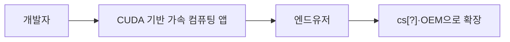

## 오늘 배운 것

- 2026년 10월 12일, 1주차 Day 1의 NVIDIA 실무자 미팅에서 하드웨어부터 소프트웨어와 산업 적용까지 이어지는 사업 범위를 살펴봄.
- CUDA와 NIM을 중심으로 가속 컴퓨팅 생태계를 배우고, AI Factory와 Physical AI의 활용 방향을 확인함.
- 신입의 경쟁력은 기술 사용 자체보다 해결할 문제를 구체화하고, 협업하며 프로젝트를 끝까지 이끄는 경험에 있음을 배움.
- AI 도구의 사용량보다 효율적인 워크플로와 검증 기준, 자신의 기여를 설명할 수 있는 기록이 중요함을 정리함.

## 핵심 개념

### NVIDIA의 사업 범위와 조직 문화

젠슨황은 NVIDIA의 창업자 3명 중 한 명이며, 현재도 CEO로 활동하고 있다고 소개함. 회사 공간에서는 삼각형 모티브와 자연광을 강조한 건물 설계가 눈에 띄었음.

NVIDIA는 하드웨어뿐 아니라 소프트웨어까지 다루는 풀스택 회사라고 설명함. 소프트웨어 개발자가 더 많으며, 개발자가 일하기 좋은 회사라는 소개도 들음. 앞으로 6개월간 AI 캠퍼스에서 배우는 내용과 NVIDIA의 기술이 맞닿는 부분이 많을 것이라고 안내함.

조직 문화를 설명할 때는 ‘러닝 머신’이라는 표현을 사용함. 게임에서 출발해 AI와 로보틱스로 확장하며 계속 학습하고 진화하는 문화임을 강조함. 매니저를 위해 움직이기보다 자신이 정한 미션을 중심으로 일하는 태도를 소개함.

### CUDA와 가속 컴퓨팅 생태계

CUDA는 가속 컴퓨팅 프레임워크로 소개함. 개발자가 CUDA 기반 애플리케이션을 만들고, 이를 최종 사용자와 더 넓은 생태계로 확산시키는 흐름을 설명함.

CUDA는 생각보다 다양한 곳에서 사용되며, CUDA-X 라이브러리도 제공된다고 설명함. 라이브러리 수는 2024년 기준 300개를 넘었고, 미팅에서는 현재 450개 이상이라고 소개함.

CUDA를 직접 다루는 경험과 관련 라이브러리를 활용하는 경험을 모두 쌓아보길 권함. 라이브러리의 수를 아는 데서 그치지 않고, 실제로 어떤 문제에 맞는지 확인하는 학습이 필요함.

새로운 모델과 아키텍처가 등장할 때마다 CUDA와의 간극을 메우기 위해 엔지니어와 Developer Relations 담당자가 노력한다고 설명함. 이런 대응이 다음 세대 GPU에도 반영되는 사이클을 소개함. Developer Relations의 역할은 코드 하나를 다른 플랫폼으로 옮기는 것뿐 아니라 생태계가 함께 이동할 수 있도록 돕는 데에도 있음을 강조함.

### AI Factory와 지속 가능한 컴퓨팅

AI Factory를 새로운 산업혁명의 흐름으로 소개함. 최근 대기업의 도입과 정부·산업의 움직임이 이어지고 있으며, 각 산업의 AI 전환을 지원하고 있다고 설명함. 앞으로의 취업 분야이자 경쟁력을 쌓을 수 있는 영역으로 바라볼 필요가 있음을 강조함.

동시에 GPU의 발열과 전력 문제도 중요한 과제로 다룸. 지속 가능한 컴퓨팅을 위해 이 문제를 고민하고 있으며, GTC 키노트에서도 관련 개선 내용을 계속 발표한다고 설명함.

AI 전환은 아직 갈 길이 멀며, 지금을 기회가 열려 있는 시기로 바라보길 권함.

### NIM과 산업별 AI 활용

NIM 서비스에서는 모델 카드를 확인하고, API를 통해 큰 모델을 테스트할 수 있다고 소개함. 여러 모델 회사와 협력하며 모델 배포에 맞춰 GPU 최적화 라이브러리도 공개한다고 설명함.

그래픽 컴퓨팅에서도 AI를 활용해 현대적인 그래픽을 재창조하는 방향을 소개함. GPU의 RT Core는 그래픽 처리 기능을, Tensor Core는 AI와 병렬 연산을 담당한다고 설명함. 게임 회사와의 협업과 클라우드 게임 서비스인 GeForce NOW도 함께 소개함.

산업별 활용으로는 제약 분야의 BioNeMo, 조선·제조업의 Physical AI 협력, Amazon Robotics의 물류 혁신 사례를 다룸. 벤츠와 현대차 등과의 협업, 자율주행 플랫폼인 NVIDIA DRIVE도 소개함. Omniverse의 활용은 로보틱스와 물류보다 자율주행이 먼저였다고 설명함.

### 초심과 실무 감각

교육과정에 임하는 자세로 초심을 유지하는 것이 중요하다고 조언함. 처음 배울 때는 새로운 내용을 민감하게 받아들이지만, 익숙해질수록 편한 길을 찾게 되므로 지금의 기대감과 마음가짐을 이어가길 권함.

AI의 변화 속도가 빨라 기존 실무자도 전문성을 단정하기 어려워지고 있다고 설명함. 경험과 맥락이 학습에 도움이 되지만, 새로운 기술 앞에서는 기존 실무자와 새로 시작하는 사람의 출발점이 이전보다 가까워지고 있으므로 자신감을 가져도 된다고 조언함.

실무 감각은 교육과정을 따라가는 것만으로 충분한지 점검할 필요가 있음. 관심 있는 회사와 직군의 사람들이 어떤 문제를 풀고 있는지, 최근 무엇을 고민하는지 물어보고 자신이라면 어떻게 해결할지 생각해보는 방법을 권함.

NVIDIA DLI 교육은 학습량이 많은 편이므로 수업 중 집중력이 필요하다고 안내함. 계획은 NVIDIA처럼 3개월 단위로 세워보자는 제안도 들음.

### 신입의 경쟁력과 포트폴리오

신입에게는 AI를 얼마나 잘 구현하는지뿐 아니라, AI로 어떤 문제를 풀고 싶은지 구체화하는 역량을 기대한다고 설명함. 유스케이스를 발굴하고 그 과정의 어려움을 해결한 경험이 포트폴리오에 도움이 됨을 강조함.

모두가 AI 도구를 사용할 수 있다면 차별화는 도구가 채우지 못하는 빈틈에서 찾아야 한다고 조언함. 사람 사이의 관계와 협력처럼 사람이 맡아야 할 역할도 중요하게 다룸.

대기업은 전문성이 뚜렷한 사람을, 스타트업은 여러 영역을 경험한 사람을 찾는 경향이 있다는 의견을 들음. 스페셜리스트와 제너럴리스트 중 자신에게 맞는 방향을 생각해볼 필요가 있음. 기술 역량과 함께 협업할 수 있는 사람인지도 중요하게 본다고 설명함.

포트폴리오에는 프로젝트를 처음부터 끝까지 주도한 경험과 자신의 손길이 들어간 부분을 담아야 함. 연차와 관계없이 각자가 프로젝트의 오너십을 갖고, 주어진 기간에 목표를 달성하기 위해 자기 역할에 맞게 기여하는 것이 리더십이라고 설명함. 팀원이 돋보이게 만드는 태도도 좋은 리더십으로 소개함.

### 오픈소스 기여와 AI 활용 기록

오픈소스 기여를 고려할 때는 자신이 실제로 기여할 만한 프로젝트인지 먼저 판단해야 한다고 조언함. 개발 사이클이 빨라지고 프로젝트가 쉽게 생기고 사라지는 만큼, 지속 가능성과 운영 주체의 신뢰성도 중요하게 봄.

짧은 기간에 기여 경험을 쌓으려면 이미 열린 PR의 의견이 얼마나 수용되는지, 실제로 머지가 이루어지는지 확인하는 것이 도움이 됨. 이슈부터 머지까지의 과정을 경험할 수 있는, 사이클이 빠른 프로젝트를 권함.

GitHub 활동은 기본적인 활동성을 보여주는 요소로 설명함. 다만 잔디의 양이나 토큰 사용량 자체보다 AI를 효율적으로 사용하는 과정이 더 중요함을 강조함.

명확한 지시와 자신만의 워크플로를 만들고, 요청이 왜 빠르거나 느렸는지 생각한 과정을 기록하면 포트폴리오에 활용할 수 있음. 에이전트에게 작업을 맡기더라도 자신의 판단과 기여를 높여가야 함.

NVIDIA 내부에서는 새로운 오픈 모델을 공유하고 의견을 나누는 문화도 소개함. 슬랙이나 이메일로 소식을 접하는 데서 끝나지 않고, 각 팀의 도입과 개선 방안으로 연결하는 흐름을 설명함.

### 도메인 지식과 문제 정의

경력 전환에서는 기존 경험을 살리는 방향을 권함. 도메인 지식의 중요성이 커지고 있으므로, 기존 분야와 AI를 함께 바라보며 역량을 확장하는 것이 좋다는 의견을 들음.

차별화를 위해서는 기존 시스템과의 연계도 중요함. 시스템 안에는 전문가들이 체계화한 지식이 담겨 있으므로, AI 기술 자체보다 무엇을 해결하려는지에 집중해야 한다고 강조함.

에이전트에게 위임할 때도 먼저 필요한 문제인지 확인해야 함. 사람이 처리해왔기 때문에 생긴 문제인지, 관계나 프로세스 때문에 생긴 문제인지 살펴볼 필요가 있음. 중간 산출물과 최종 산출물을 기준으로 정하고 모니터링하는 방법을 설명함.

비개발 직무에서도 기존 전공이나 업무와의 연결고리를 찾아 AI로 어떻게 문제를 해결하는지 보여주는 방향을 권함. 자신의 일뿐 아니라 다른 사람의 미션 달성을 위해 무엇을 도울 수 있는지 고민하는 태도도 강조함.

### 모델 선택과 평가 기준

현업에서는 API 모델의 성능이 좋아 이를 활용하는 경우가 많다고 설명함. 반면 반도체·금융처럼 외부 인터넷 사용이 제한된 폐쇄망 환경에서는 보안 때문에 오픈 모델을 직접 운영하는 경우를 소개함.

여러 에이전트와 모델의 장점을 조합하는 방식이 유리할 수 있으며, 산업 수준에서는 도메인이나 기능에 특화된 모델도 만들어지고 있다고 설명함.

새 모델을 도입할 때는 AI에 기존 하네스 흐름을 점검하게 하고, 변경할 부분을 찾아 테스트하는 방식을 소개함. 다만 발언자는 하네스를 직접 설계해본 경험은 없다고 밝힘. 복잡한 루프를 직접 설계하기보다 기본 형태나 이미 마련된 방식을 사용하는 편이 낫다는 의견도 덧붙임.

어떤 방식이든 평가·검증 대상과 이전보다 나아졌다고 판단할 기준은 각자가 가져야 함을 강조함.

### AI의 한계와 에이전트의 전망

AI를 많이 사용하면 좋은 결과를 얻을 수 있더라도, 무작정 사용량을 늘릴 수는 없다고 설명함. 특히 거버넌스 문제에는 정답이 없는 경우가 있으므로, 결과가 실제로 유용한지 판단하는 역량이 중요함.

AI 덕분에 할 수 있는 일이 늘어났지만 해야 할 일도 많아지고, 다음 작업으로 이어갈 때 유지해야 할 맥락도 커지고 있다고 설명함.

에이전틱 AI는 변화 속도가 빨라 앞으로 어떤 영역에서 부상할지 예측하기 어렵다고 봄. 메타의 스마트 글래스 기반 에이전트 흐름을 언급하며, 예상하지 못한 도메인으로 확장될 가능성을 이야기함.

Physical AI에서도 가사 일을 하는 기계처럼 상호작용이 필요한 경우에는 에이전틱 AI가 중요할 수 있음. 반면 공장에서는 그 중요성이 상대적으로 낮을 수도 있다는 의견을 들음.

### 채용 준비와 소통 역량

NVIDIA 채용 정보는 공식 홈페이지와 LinkedIn에서 확인할 수 있다고 안내함. 직무 기술서를 읽으면 어떤 역량을 준비해야 하는지 아이디어를 얻을 수 있으므로 많이 읽어보길 권함.

개발자 채용에서는 기술적 깊이와 문제 해결 능력을 중요하게 보며, 인터뷰가 많으면 10회까지 진행될 수 있다고 설명함. Developer Relations는 개발자와 비즈니스를 함께 다루는 직무로 소개함.

재취업과 해외 취업에 대해서는 나이나 경력보다 해당 조직에서 무엇을 하고 싶은지 분명히 하는 것이 중요하다고 조언함. 해외 회사의 소통 역량은 언어 능력만의 문제가 아니며, 소프트 리더십도 중요하게 봄.

## 예시·코드

### 제조업 문제를 출발점으로 한 프로젝트

포트폴리오 사례로 배터리 제조업의 공정 단계에서 문제를 찾고, 품질 관련 에이전트를 발굴하는 방향을 소개함. 업무 효율을 높이기 위한 구체적인 예시로 다음 프로젝트를 언급함.

- RAG 챗봇을 구현함.
- 보고서 작성 과정을 자동화함.
- 여러 문서를 비교하는 기능을 구현함.

기능을 만드는 데서 끝내지 않고, 어떤 업무 문제를 발견했는지와 자신이 어떤 판단을 내렸는지 설명할 수 있어야 함. 결과물을 자신의 요구에 맞게 다듬고, 처음부터 끝까지 이끌었다고 말할 수 있는 경험을 담는 것이 중요함.

## 어려웠던 점·느낀 점

AI 기술의 변화가 빨라 실무자도 계속 새로 배워야 한다는 점이 인상적이었음. 기존 경험은 도움이 되지만, 새로운 기술 앞에서는 초심과 학습 태도가 여전히 중요함을 확인함.

AI가 작업을 대신해주더라도 문제 정의와 검증, 맥락 유지는 사람이 맡아야 한다는 점을 생각하게 됨. 결과물을 많이 만드는 것보다 실제로 유용한지 판단하고 자신의 기여를 설명하는 일이 중요함을 배움.

## 다음에 할 것

- CUDA를 직접 다루는 방식과 CUDA-X 라이브러리를 활용하는 방식을 모두 탐구하고, 실제 적용할 문제를 찾아봄.
- 관심 있는 회사의 직무 기술서를 읽고, 현업에서 해결하는 문제를 조사해 자신만의 해결 방향을 정리함.
- 기존 전공과 경력에서 AI로 개선할 수 있는 문제를 발굴하고, 스페셜리스트와 제너럴리스트 중 자신에게 맞는 방향을 검토함.
- 오픈소스 프로젝트의 PR 수용과 머지 흐름을 살펴보고, 실제 기여할 수 있는 프로젝트를 탐색함.
- AI 요청의 속도와 효율, 워크플로의 변경 이유를 기록해 포트폴리오에 남김.
- 3개월 단위로 학습 계획을 세우고, 프로젝트의 중간·최종 산출물과 평가 기준을 구체화함.
