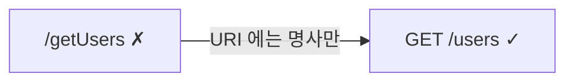

## 오늘 배운 것

REST 는 자원(Resource)을 URI 로 표현하고, 행위는 HTTP 메서드로 나타내는 방식이다. 실습으로 게시판 API URI 를 설계해 봤다.

## 핵심 개념

- URI 에는 명사만 쓴다. 동사는 넣지 않는다 (`/getUsers` ✗ → `GET /users` ✓)
- 복수형을 쓰는 게 관례라고 하셨다
- 계층 관계는 `/` 로 표현: `/users/1/orders`
- 무상태(stateless): 서버가 클라이언트 상태를 저장하지 않고, 요청마다 필요한 정보를 다 담는다
- 상태코드를 제대로 쓴다: 201 Created, 204 No Content, 404

## 예시·코드



```http
GET /users
/users/1/orders
```

## 어려웠던 점·느낀 점

- PUT 이랑 PATCH 차이가 헷갈린다. 전체 교체 vs 부분 수정 [?]

> 💡 보충: PUT 은 자원 전체를 교체하고, PATCH 는 일부만 수정한다.
