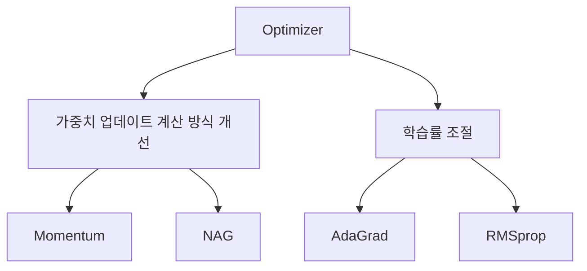

## 오늘 배운 것

- Batch Size는 한 번의 업데이트에 사용하는 데이터 수이며, Epoch와 Step은 학습 진행을 구분하는 단위임.
- Full Batch, Stochastic SGD, Mini-Batch는 업데이트 빈도와 안정성, 한 번에 처리하는 데이터의 부담이 서로 다름.
- Optimizer는 이동 방향과 관성을 개선하거나 파라미터별 학습률을 조절해 손실을 줄이는 방법임.

## 핵심 개념

### Batch Size, Iteration, Epoch

- **Batch Size**: 가중치를 한 번 업데이트할 때 사용하는 데이터 개수를 뜻함.
- **Iteration(Step)**: 하나의 Batch를 학습하고 가중치를 한 번 업데이트하는 과정을 뜻함.
- **Epoch**: 전체 학습 데이터를 한 번씩 사용해 학습하는 과정을 뜻함.

마지막 Batch를 버리지 않는 경우, 1 Epoch당 업데이트 횟수는 다음과 같이 계산함.

**업데이트 횟수 = ceil(전체 데이터 수 / Batch Size)**

### Full Batch: 전체 데이터를 한 번에 사용함

전체 데이터를 한 번에 학습하고 가중치를 업데이트하는 방식임.

- 전체 데이터를 종합하므로 업데이트가 안정적이며, 급격한 변화가 적음.
- 한 번에 많은 데이터를 처리하므로 병렬 연산에 유리함.
- 전체 데이터를 처리해야 한 번 업데이트할 수 있어, 데이터가 많아지면 처리 부담이 커짐.
- 업데이트 횟수가 적어 학습이 느리게 진행될 수 있음.

한 번의 업데이트로 학습이 완성되는 것은 아니며, 여러 Epoch가 필요할 수 있음.

### Stochastic SGD: 데이터를 하나씩 사용함

데이터 하나를 학습할 때마다 즉시 가중치를 업데이트하는 방식임.

- 한 번에 하나의 데이터만 처리하므로 메모리 부담이 적음.
- 가중치를 자주 업데이트하므로 초기에는 목표에 빠르게 접근할 수 있음.
- 개별 데이터에 따라 업데이트 방향이 크게 달라져 결과가 흔들릴 수 있음.
- 업데이트 횟수가 많아 반복적인 연산 비용이 발생하며, 안정적인 결과에 도달하기 어려울 수 있음.

전체 데이터를 한 번씩 사용하더라도, 전체 데이터를 동시에 종합해 업데이트하는 방식은 아님.

### Mini-Batch: 작은 그룹으로 나누어 사용함

전체 데이터를 작은 그룹으로 나누고, 각 그룹을 학습할 때마다 가중치를 업데이트하는 방식임.

- Full Batch보다 자주 업데이트할 수 있음.
- Stochastic SGD보다 여러 데이터를 종합하므로 상대적으로 안정적임.
- 병렬 연산을 활용하면서 메모리 사용량을 조절할 수 있음.
- 학습 속도와 안정성, 연산 효율의 균형을 맞추기 좋음.
- 그룹 구성과 Batch Size에 따라 업데이트 방향, 학습 속도, 안정성이 달라질 수 있음.

그룹을 구성할 때는 **몇 개씩 묶을지**, **어떤 데이터를 함께 묶을지**, **어떤 순서로 사용할지**를 고려해야 함. 일반적으로 학습 데이터의 순서를 무작위로 섞는 Shuffle을 사용해 그룹을 구성함.

실제 딥러닝에서는 일반적으로 Mini-Batch 방식을 사용함.

### 세 가지 방식의 차이

| 구분 | Full Batch | Stochastic SGD | Mini-Batch |
|---|---|---|---|
| 한 번의 처리 부담 | 큼 | 작음 | 중간 |
| 학습 안정성 | 높음 | 낮음 | 중간 |
| 업데이트 빈도 | 낮음 | 높음 | 중간 |
| 초기 손실 감소 | 느릴 수 있음 | 빠를 수 있음 | 빠를 수 있음 |
| 목표 손실 도달 시간 | 상황에 따라 다름 | 상황에 따라 다름 | 상황에 따라 다름 |

Batch Size가 작다고 반드시 전체 학습 시간이 짧아지는 것은 아님. 업데이트 빈도뿐 아니라 목표 손실에 도달하는 데 걸리는 시간도 함께 구분해야 함.

### Optimizer: 가중치를 효율적으로 업데이트함

Optimizer는 손실(Loss)을 줄이기 위해 가중치를 효율적으로 업데이트하는 방법임. 수업에서는 크게 두 가지 접근으로 구분함.

**이동 방향과 관성을 개선하는 방식**

- **Momentum**: 이전 기울기의 이동 방향을 누적해 관성을 적용함.
- **NAG**: 관성으로 이동할 위치를 미리 예상하고, 그 위치의 기울기를 계산해 업데이트함.

**파라미터별 학습률을 조절하는 방식**

- **AdaGrad**: 기울기 제곱을 누적해, 자주 큰 기울기가 발생하는 파라미터의 학습률을 줄임.
- **RMSprop**: 최근 기울기의 제곱을 더 중요하게 반영해, AdaGrad의 학습률이 계속 감소하는 문제를 완화함.

## 예시·코드

학생 30명에게 적합한 교육 난이도를 찾는 상황으로 학습 과정을 설명함.

| 학습 요소 | 교육 난이도 예시 |
|---|---|
| 목표 | 학생 30명의 수준에 적합한 교육 난이도를 결정함 |
| 데이터 | 학생 30명의 의견에 해당함 |
| 모델 | 교육 난이도를 결정하는 기준에 해당함 |
| 학습 | 학생들의 의견을 반영해 교육 난이도를 수정하는 과정임 |
| Epoch | 학생 30명 전체의 의견을 한 번씩 확인하는 과정임 |
| Batch Size | 한 번의 상담에서 의견을 수집하는 학생 수에 해당함 |
| 가중치 업데이트 | 상담 결과를 반영해 교육 난이도를 수정하는 과정임 |

### 상담 단위에 따른 차이

- **Full Batch**: 학생 30명의 의견을 모두 수집한 뒤 교육 난이도를 한 번 수정함.
- **Stochastic SGD**: 학생 한 명과 상담할 때마다 그 의견을 반영해 교육 난이도를 수정함.
- **Mini-Batch**: 학생 30명을 5명씩 6개 그룹으로 나누고, 그룹별 상담이 끝날 때마다 교육 난이도를 수정함.

| 구분 | Full Batch | Stochastic SGD | Mini-Batch |
|---|---:|---:|---:|
| Batch Size | 30 | 1 | 5 |
| 1 Epoch당 사용하는 학생 의견 수 | 30 | 30 | 30 |
| 1 Epoch당 상담 횟수 | 1 | 30 | 6 |
| 1 Epoch당 난이도 수정 횟수 | 1 | 30 | 6 |

Batch Size를 8로 정하면 **8명, 8명, 8명, 6명**으로 나누어 상담하므로, 1 Epoch당 업데이트 횟수는 4번임. 이는 마지막 6명의 Batch를 버리지 않는 경우를 가정함.
